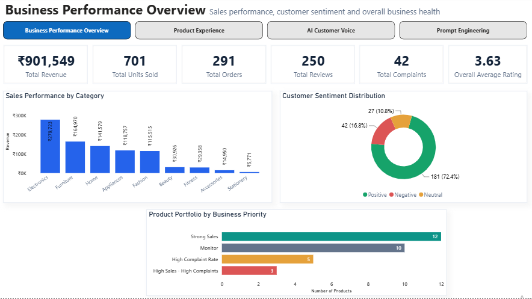
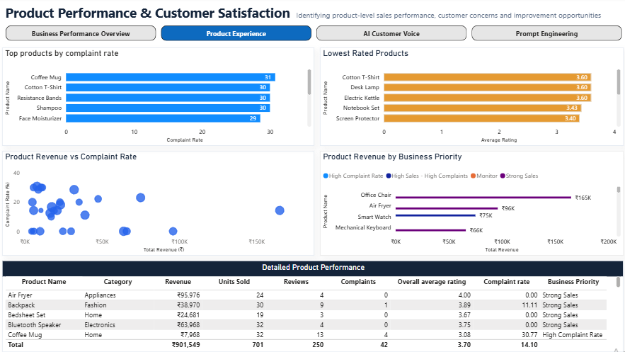
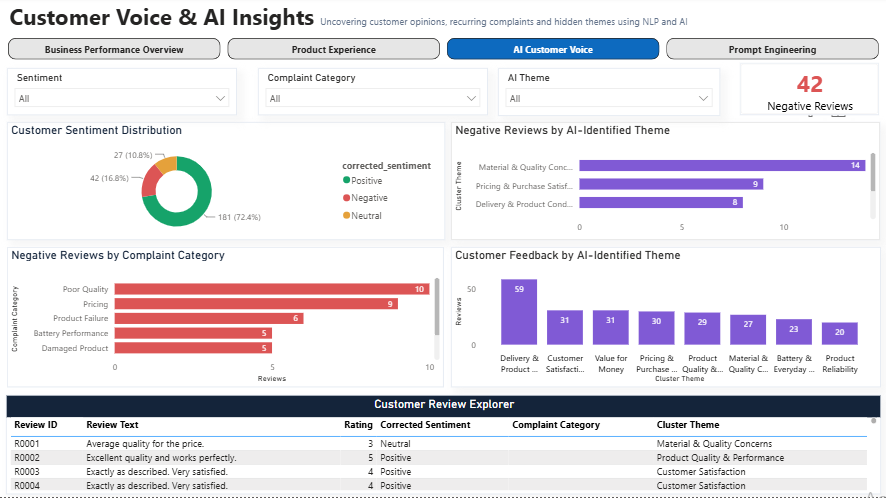
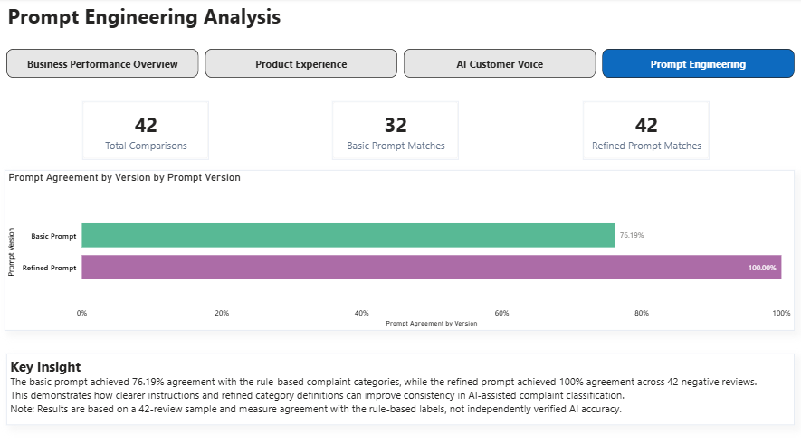

# E-commerce Intelligence & AI Analytics

An end-to-end data analytics project that combines Python, SQL, AI-driven customer review analysis, and Power BI to transform e-commerce data into actionable business insights.

## Project Overview

This project focuses on analyzing e-commerce business performance, understanding customer satisfaction, identifying recurring product complaints, and exploring how AI-assisted text analysis can improve customer feedback classification.

The project covers the complete analytics workflow, from data preparation and exploratory analysis to sentiment analysis, customer review clustering, prompt engineering, and interactive business intelligence dashboards.

### Key Technologies

- Python
- SQL (MySQL)
- Power BI
- DAX
- Pandas, NumPy
- VADER Sentiment Analysis
- Sentence Transformers
- K-Means Clustering


## Business Objectives

The main objectives of this project are:

1. **Analyze Business Performance:** Evaluate product revenue, sales performance, and business priorities.
2. **Understand Customer Sentiment:** Classify customer reviews into positive, negative, and neutral sentiments.
3. **Identify Product Issues:** Analyze negative reviews to identify recurring complaint categories and product quality concerns.
4. **Discover Customer Feedback Themes:** Apply text embeddings and clustering to group similar customer reviews.
5. **Evaluate AI Classification:** Compare basic and refined prompts to assess improvements in AI-assisted complaint categorization.
6. **Build Interactive Dashboards:** Present business insights through Power BI visualizations and interactive reports.

## Project Workflow

The project follows an end-to-end analytics workflow:

1. **Data Generation & Preparation**
   - Created structured e-commerce datasets for products, orders, and customer reviews.
   - Cleaned and prepared data for analysis.

2. **Exploratory Data Analysis**
   - Examined product, sales, and customer review data.
   - Identified patterns and key business metrics.

3. **Sentiment Analysis**
   - Applied VADER to classify customer reviews.
   - Analyzed positive, negative, and neutral feedback.

4. **AI-Based Review Clustering**
   - Generated sentence embeddings using Sentence Transformers.
   - Applied K-Means clustering to identify recurring customer feedback themes.

5. **Prompt Engineering**
   - Compared basic and refined prompts for complaint classification.
   - Evaluated classification agreement against rule-based categories.

6. **SQL Analysis**
   - Stored and queried structured datasets using MySQL.
   - Performed data validation and analytical queries.

7. **Power BI Dashboard**
   - Built interactive dashboards to analyze business performance, product experience, customer sentiment, and AI insights.
  

## Power BI Dashboard

The interactive Power BI report consists of four pages:

### 1. Business Performance Overview
- Business performance KPIs


- Revenue and sales analysis


- Sentiment distribution


- Business priority overview


### 2. Product Performance & Customer Satisfaction
- Product revenue vs. complaint rate
- Products with the highest complaint rates
- Lowest-rated products
- Revenue by business priority
- Detailed product performance table

### 3. Customer Voice & AI Insights
- Customer sentiment distribution
- Complaint category analysis
- Negative reviews by AI-generated cluster theme
- Overall customer review themes
- Interactive customer review explorer

### 4. Prompt Engineering
- Basic vs. refined prompt comparison
- Complaint classification agreement
- Key findings from AI-assisted classification

The dashboard includes interactive slicers, cross-filtering, and page navigation.


## Key Findings

- Analyzed **250 customer reviews** across positive, negative, and neutral sentiment categories.
- Identified **42 negative reviews** and categorized recurring product complaints.
- Discovered recurring customer feedback themes using sentence embeddings and K-Means clustering.
- The basic prompt achieved **76.19% agreement** with rule-based complaint categories.
- The refined prompt achieved **100% agreement** across the same 42-review sample.

**Note:** Prompt agreement measures consistency with the rule-based labels in this sample. It does not represent independently verified AI classification accuracy.

## Project Structure
```text
ecommerce_ai_project/
│
├── data/
│   ├── raw/
│   │   ├── products.csv
│   │   ├── orders.csv
│   │   └── reviews.csv
│   │
│   └── clean/
│       └── Processed and analysis-ready CSV datasets
│
├── notebooks/
│   ├── 01_generate_data.ipynb
│   └── 02_sentiment_analysis.ipynb
│
├── outputs/
│
├── powerbi/
│   └── Ecommerce_Intelligence_Dashboard_Final.pbix
│
└── sql/


